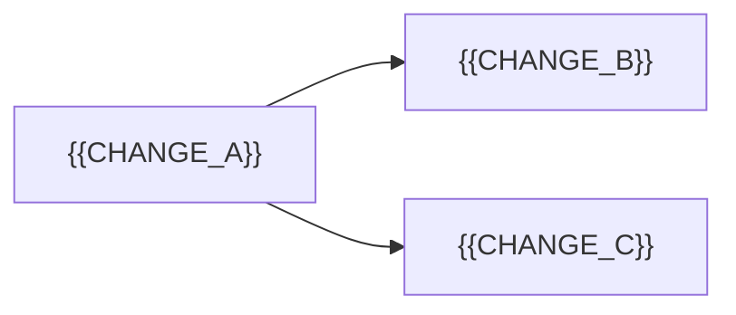

# Stage {{STAGE_NUMBER}} Change Map：{{STAGE_TITLE}}

> 状态：draft
> 日期：{{DATE}}
> 归属：`docs/stages/stage-{{STAGE_NUMBER}}-<slice>-brief.md`
> 负责人：{{OWNER}}；评审：{{REVIEWER}}
> 权威来源：§3 变更清单是本文件唯一的事实表；§4 图、§5 波次、§7 顺序都由它派生。

## 1. 用途与边界

本文件回答一个问题：这个 Stage 的 change 按什么顺序做、能并行到什么程度、每一批结束时要过什么门。

- 是：拆解、依赖、并行分批、共享资源归属、合并/归档顺序和门记录的**计划文档**。
- 不是：OpenSpec artifact。它不进 `openspec/`，不被 `openspec validate` 校验，也不改变任何 change 的 specs。
- 不是：调度器。没有运行时、没有队列、没有自动放行；agent 读本文件后按步骤执行，门由人确认。
- 不是：状态真源。change 的任务进度看 `openspec status`，Stage 的范围状态看 brief。

OpenSpec 只有单个 change 内部的 artifact 依赖，没有跨 change 依赖模型；本文件是这层信息的唯一真源。Stage 计划两个以上 change 时创建本文件；只有一个 change 时 brief §4 足够。

## 2. 拆解原则

1. 一个 change 一个行为边界：能独立评审、实现、验证、归档。
2. 能力归属唯一：同一 `openspec/specs/<capability>/` 的 delta 只由一个 change 主写；第二个 change 要改同一能力时，排在其后并沿用同一 capability。
3. 目录归属唯一：每个目录在 §6 有唯一 owner；非 owner 只提补丁。
4. 共享清单文件（依赖清单、lockfile、聚合配置、部署清单）由 owner 在门内统一更新，其他 change 只交自己的片段。
5. 粒度以“一次评审能看完”为准；宁可先拆大，也不要把整个 Stage 塞进一个 change。
6. 超出本 Stage 的行为写进下一 Stage 或开放决策，不塞进当前 change。

## 3. 变更清单（权威表）

| Change | Capability | depends_on | wave | 负责目录 | 主要交付 | Stage AC |
| --- | --- | --- | --- | --- | --- | --- |
| `{{CHANGE_A}}` | `{{CAPABILITY_A}}` | — | 0 | `{{DIR_A}}` | {{DELIVERY_A}} | S{{STAGE_NUMBER}}-AC-01 |
| `{{CHANGE_B}}` | `{{CAPABILITY_B}}` | `{{CHANGE_A}}` | 1 | `{{DIR_B}}` | {{DELIVERY_B}} | S{{STAGE_NUMBER}}-AC-02 |
| `{{CHANGE_C}}` | `{{CAPABILITY_C}}` | `{{CHANGE_A}}` | 1 | `{{DIR_C}}` | {{DELIVERY_C}} | S{{STAGE_NUMBER}}-AC-03 |

字段规则：

- `Change`：与 `openspec/changes/<name>/` 目录名逐字一致。
- `Capability`：该 change 主写的 capability；写多个时用 `、` 分隔，第一个为主。
- `depends_on`：只写“允许开始”的前置 change，逗号分隔，无依赖写 `—`。依赖是使能条件：它说明可以开始了，不说明必须停在这里。
- `wave`：批次编号，成员以本列为准。同一 wave 的 change 必须两两无依赖，且不写同一目录、不写同一主 capability。
- `负责目录`：该 change 独占写的路径；多个用 `、` 分隔。
- `Stage AC`：brief 里的编号，一个 change 可覆盖多条。
- 状态不写在这里：任务进度看 `openspec status --change <name>`，范围状态看 brief。

## 4. 依赖图



- 边 = “生产者完成并通过门后，消费者才能开始”。
- 图必须与 §3 的 `depends_on` 一致；两者不一致时以 §3 为准，并立刻补图。
- 共享文件的生产者 → 消费者关系也要画成边，与 §6 对应。

## 5. 并行波次与门

分批规则：

- wave 是**人工分批**，不是拓扑排序的层。分几批由人决定，依据必须写在每个 wave 下：环境/实例数量、评审带宽、合并冲突、外部依赖、团队人数。
- 同一 wave 内的 change 可以同时开工；不同 wave 之间按门推进。
- 依赖只表示“可以开始”。前一批提前完成不等于后一批自动获准，仍要过门。
- 关键路径单独点出：哪一批是串行瓶颈、哪一批决定 Stage 的最早完成时间。
- 门的通过状态以 §10 的记录为准；**没有记录就是未通过**。

### Wave 0 — {{WAVE_0_THEME}}

- 成员：§3 中 `wave=0` 的行。
- 分批依据：{{WHY_WAVE_0}}（例：基座必须先落地，后续 change 才能编译或联调）。
- 门 G0：
  - 机械检查：

    ```bash
    openspec validate --all --strict
    openspec status --change {{CHANGE_A}}   # 对本 wave 每个成员各执行一次
    ```

  - 人工检查：{{REVIEW_G0}}（例：负责人确认基座接口稳定，不再改公共类型）。
  - 证据落点：{{EVIDENCE_G0}}
  - 通过后：在 §10 记一行 `G0 | pass`。

### Wave 1 — {{WAVE_1_THEME}}

- 成员：§3 中 `wave=1` 的行。
- 分批依据：{{WHY_WAVE_1}}。
- 进入条件：§10 有 G0 的 pass 记录；没有记录时停止，先问负责人。
- 门 G1：
  - 机械检查：

    ```bash
    openspec list --json                 # 对照 §3 的 wave 成员；多出的说明提前开工或未归档
    openspec validate --all --strict
    ```

  - 人工检查：{{REVIEW_G1}}
  - 证据落点：{{EVIDENCE_G1}}

### Wave 2 — {{WAVE_2_THEME}}

- 成员：§3 中 `wave=2` 的行。
- 分批依据：{{WHY_WAVE_2}}。
- 进入条件：§10 有 G1 的 pass 记录。
- 门 G2：
  - 机械检查：`openspec validate --all --strict`
  - 人工检查：{{REVIEW_G2}}
  - 证据落点：{{EVIDENCE_G2}}

没有第三批时删掉本节。

## 6. 共享资源所有权

### 6.1 目录与文件

| 路径 | owner change | 其他 change 怎么做 |
| --- | --- | --- |
| `{{SHARED_PATH_1}}` | `{{OWNER_1}}` | 提补丁或片段，由 owner 在门内合入 |
| `{{SHARED_MANIFEST}}` | `{{OWNER_2}}` | 只声明自己模块的条目，统一由 owner 更新并验证 |

### 6.2 Capability

| Capability | owner change | 归档顺序 | 说明 |
| --- | --- | --- | --- |
| `{{CAPABILITY_A}}` | `{{CHANGE_A}}` | 先 | 后续 change 复用同名 capability，不另建 |
| `{{CAPABILITY_B}}` | `{{CHANGE_B}}` | 后 | 基于 A 的归档结果 |

规则：

- 同一 capability 的多个 change 必须串行归档；后归档者的 delta 基于前者的归档结果。
- 归档冲突按 capability 路径判定；同 wave 内不要让两个 change 写同一路径。
- 改别人的目录前先在 §10 记录，并按 6.1 提补丁；直接改算门失败。

## 7. 合并与归档顺序

- 合并顺序：`depends_on` 的拓扑序；同 wave 内按 §3 行序。
- 归档时机二选一，在本节写明：
  - **逐 wave 归档（推荐）**：每个门通过后归档该 wave 的 change。冲突早暴露，主规格早更新。
  - **Stage 退出时统一归档**：只有 §6.2 已为每个 capability 声明唯一归档顺序时才能选。
- 归档前每个 change 都要过 §8；`openspec archive <change>` 之后在同一次记录里更新 §10。
- 归档不在 §3 留状态：结果只体现在 `openspec list --archived` 和主规格。

选：{{ARCHIVE_MODE}}（逐 wave / Stage 退出）

## 8. 每个 change 的完成定义

- [ ] `proposal.md`、delta specs、`tasks.md`、`traceability.md` 齐备；`design.md` 只在需要时写。
- [ ] `openspec validate --all --strict` 通过。
- [ ] 每个 task 写了验证方式，勾选前有证据。
- [ ] 成功、无效输入、关键拒绝路径都有验证。
- [ ] 覆盖的 Stage AC 在 traceability 有证据，或明确标 `not passed`。
- [ ] 只改 §6 分配给自己的路径；共享文件经 owner 合入。
- [ ] 没有删除断言、扩大 skip 或伪造证据。
- [ ] 归档前由 {{REVIEWER}} 确认。

## 9. Agent 提示包

给每个 change 的执行 agent：

- 本文件 §3 的对应行、§5 当前 wave 的门、§6 的归属、§8 的完成定义；
- `AGENTS.md` 和 `docs/architecture.md` 的相关章节；
- `openspec/changes/<change>/` 全部文件；
- 允许写的目录清单和禁止写的目录清单；
- 停止条件：需要跨 wave、需要改共享文件、需要扩大 scope、门未记录通过、发现 brief 或规格冲突。

## 10. 门记录与偏差

| 日期 | Wave | 门 | 结论 | 证据 | 执行人 |
| --- | --- | --- | --- | --- | --- |
| {{DATE}} | 0 | G0 | pass / fail | {{EVIDENCE_LINK}} | {{OWNER}} |

偏差记录：提前开工、绕过门、改了别人的目录、依赖图与实际不符 —— 每条一行，写清影响和补救。

- {{DEVIATION_1}}

## 11. 计划变更日志

| 日期 | 变更 | 原因 | 影响的 wave |
| --- | --- | --- | --- |
| {{DATE}} | 初版 | — | — |

计划变更需要负责人确认；已通过的门的记录不改写，只追加。
